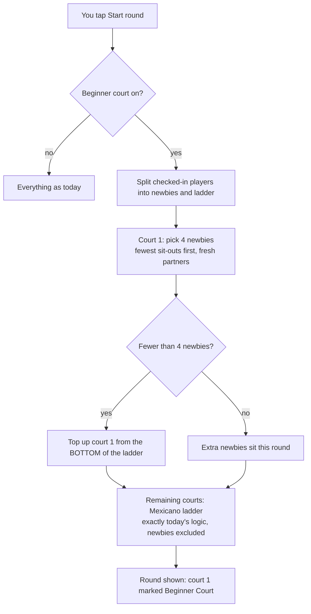

# PadelTime: the Beginner Court

A plan you can read first, with pictures. Engineering detail is at the end.

---

## 1. Why (what the Oct 29 night showed)

Facts pulled from the production database for "Thursday Oct 29" (22 players, 3 courts, Mexicano, 16 points, 7 rounds):

- Self-rated levels: six 4s, seven 3s, nine 2s, two blank. Nobody picked 1 (newbie). Jessica, Tzlil and Mendel all sat at the same level 2.
- After 2 games the scoreboard could not tell good from bad. Steven (advanced) was bottom-six after being dealt Jessica as a partner (lost 4-12). Karen was tied first after 2 games and finished 14th. Eytan was top-eight after 2, then lost 4-12.
- The fair sit-out rotation gave Louis (0 wins in 5, worst average of anyone who stayed) the most games of the night.
- 4 of the 5 blowouts (8+ point margins) had a level-2/blank player on a non-beginner court.
- Every score was entered by the organizer. All players were guests; nothing about them survives to next week.

Conclusion: the engine cannot identify a true beginner from 2 or 3 results. The organizer can, in one look. The app's job is to make that one tap, keep the pools apart, and remember it.

---

## 2. The idea in one picture

Court 1 (the first court you rented) is always the Beginner Court. Everyone you tag as a **newbie** lives there. Everyone else is in the **ladder** (Mexicano, exactly as today) on the other courts. The two pools never share a court unless *you* move someone.

```
           ┌─────────────────────────────┐   ┌─────────────────────────────────────────────┐
           │     BEGINNER COURT  (court 1)│   │     THE LADDER  (courts 2, 3, …)            │
           │                             │   │                                             │
  newbies ─►  4 play, rest sit           │   │  Mexicano as today: ranked by points/game,  │
           │  rotation = Americano style  │   │  top four on the highest court, balanced    │
           │  (new partner each round)    │   │  split 1&4 vs 2&3                          │
           │  own standings table         │   │  own standings table                        │
           └──────────────┬──────────────┘   └───────────────────┬─────────────────────────┘
                          │        "move up"  (your tap)         │
                          └──────────────────────────────────────►
                          ◄──────────────────────────────────────┘
                                   "move down"  (your tap)
```

Two courts or three, the shape is the same. With 2 courts: court 1 beginners, court 2 the whole ladder.

---

## 3. How the pool works, round by round

### Who is in which pool

- A player is a **newbie** if you tagged them. The tag is set at check-in (one tap per name) and, in phase 2, remembered by name in your group for next week.
- Everyone else, including untagged late arrivals, is in the **ladder**.
- Nothing about self-rating decides this. The existing 1–4 level still exists and still steers the ladder's first two games, but the newbie tag is separate and yours alone.

### Dealing a round (both pools in the same tap)



### Example: last Thursday replayed with the beginner court on

Assume you had tagged the 8 obvious newbies (Jessica, Tzlil, Louis, Sofia, Aaron, Seth, Eytan, Rijon) and left Mendel and Rachel in the ladder.

```
Round 1    Court 2 (beginner)   Court 3 (ladder)        Court 4 (ladder)       Sitting
           Jessica + Louis      Abraham + Aryeh         Isaac + David          4 newbies,
           vs Tzlil + Sofia     vs Matteo + Jacob       vs Simon + Zach        2 ladder

Round 3    Court 2 (beginner)   Court 3 (ladder top)    Court 4 (ladder)
           Seth + Eytan         Simon + Jacob           Mendel + Karen
           vs Rijon + Aaron     vs Abraham + Michael    vs Mark + Zach
```

What changes versus what actually happened:

| | Actual Oct 29 | With beginner court |
| --- | --- | --- |
| Steven's partners | 4 of 5 games with a level-2 partner, avg 7.2 | Never partnered with a newbie |
| Blowouts on ladder courts | 4 | ~0 (the 4 involved a newbie) |
| Games per newbie | 3 to 5 | ~3 (8 newbies share one court: 4 play, 4 sit) |
| Games per ladder player | 3 to 5 | ~4.5 (14 players share 2 courts) |
| Who Jessica plays | Steven, Rachel, Jacob | Other newbies. She can win a game |

Note the court-time cap falls out of the design: one court **is** the cap. No knockout needed.

### Sit-outs (who watches each round)

Default: fair rotation **inside each pool**, like today. Nobody's sit-out count gets more than one ahead of anyone else in their pool.

Optional per-night toggle, **Competitive sit-outs**: once everyone in a pool has played the minimum (3 games), the sit-outs go to the bottom of that pool's table instead of rotating. Top ladder players then play nearly every round late in the night; the weakest watch more. Off by default; flip it on for nights billed as a tournament.

```
                         rounds 1–3                     rounds 4+
Equal (default)          rotate fairly                  rotate fairly
Competitive toggle ON    rotate fairly (the floor)      bottom of each pool sits
```

### Moving between pools

```mermaid
sequenceDiagram
    participant You as You (organizer)
    participant App
    participant Mendel
    App->>You: nudge "Mendel: 3 straight wins on the beginner court"
    You->>App: tap Move up
    App->>Mendel: next round he is dealt into the ladder (enters at the bottom court)
    Note over App: his beginner-court points stay in the beginner table; ladder table starts at 0
    App->>You: nudge "Louis: 0 wins after 3 ladder games"
    You->>App: tap Move down
    App->>Mendel: (not affected)
    App->>You: Louis plays court 1 from the next round
```

Rules:

- The app **never** moves anyone by itself. It only nudges.
- Move up puts the player into the ladder at the bottom (they earn their way up by results, like a late arrival today).
- Move down puts a ladder player on court 1 from the next round.
- Moves take effect at the next round. The round in play is untouched.

---

## 4. What you see as supervisor

### Setup screen (new bits in **bold**)

```
Night: Thursday Nov 6         Courts: 3  (labels 2, 3, 4)       Points: 16   Time: 90 min
Format: Mexicano
**[x] Beginner court — court 2 is reserved for newbies**
**[ ] Competitive sit-outs — after 3 games each, the bottom of each pool sits**

Setup summary
  Ladder: 14 players on 2 courts → ~4.5 games each, 1–2 sit per round
  **Beginner court: 8 newbies on 1 court → ~3 games each, 4 sit per round**
  **Tip: admit at most 7 newbies for a 1-court beginner pool (keeps them on court 2 rounds in 3)**
```

The tip is the number you hold on Partiful. The app cannot stop sign-ups there; it tells you the number.

### Check-in / roster

```
  Name       Level   Newbie   Status
  Abraham     4       [ ]     checked in
  Jessica     2       [x]     checked in      ← one tap
  Mendel      2       [ ]     checked in      ← untick = ladder
  Sofia       –       [x]     checked in
  Aaron       –       [ ]     waitlist
```

Phase 2: the Newbie box and level are pre-filled from last week by name; you confirm.

### Live screen

```
┌ Court 2 · BEGINNER COURT ─────────────┐  ┌ Court 3 ──────────────┐  ┌ Court 4 ──────────────┐
│ Jessica + Louis   vs  Tzlil + Sofia   │  │ Simon + Jacob          │  │ Mendel + Karen         │
│ [ 7 ] – [ 9 ]                         │  │ vs Abraham + Michael   │  │ vs Mark + Zach         │
└───────────────────────────────────────┘  └────────────────────────┘  └────────────────────────┘
Sitting (beginner court): Seth, Eytan, Rijon, Aaron
Sitting (ladder): Isaac, Steven

Nudges:  ▲ Mendel — 3 straight wins on court 2   [Move up]
         ▼ Louis — 0 wins after 3 ladder games   [Move down]

Standings            Beginner court
 1 Simon 10.4         1 Rijon 8.5
 2 Abraham 10.0       2 Eytan 8.0
 …                    …
```

Everything else (next court / deal ahead, tap-the-court review, team swaps, score entry) works as it does today. Deal-ahead keeps working per pool: court 1 can be re-dealt as soon as its game ends, without waiting on the ladder courts.

### Edge cases, decided

| Situation | What happens |
| --- | --- |
| Fewer than 4 newbies checked in | Court 1 is topped up from the bottom of the ladder for that round |
| 0 newbies | Court 1 is just a ladder court (toggle has no effect that night) |
| Newbie arrives late | Joins the beginner pool's rotation with a credited sit-out share, like today's late arrivals |
| 2 courts, 6 newbies + 6 ladder | Each pool has one court; everyone plays 2 of 3 rounds. "Competitive" on → ladder bottom sits more after 3 games |
| A helper (phase 2) | You pin one ladder player to court 1 for the night; they are left out of the ladder table |
| Mixed pairs toggle on | Applies inside each pool separately |
| Fixed teams on | Beginner court toggle is hidden (teams already decide who plays with whom) |

---

## 5. Phasing

**Phase 1 (this build):** beginner court toggle, newbie tag at check-in, dual-pool dealing, two standings tables, move up / move down, nudges, setup summary + "admit at most N" tip, competitive sit-outs toggle with 3-game floor.

**Phase 2 (next):** remember newbie tag + level + last average by name in the group; pre-fill at join; post-night "confirm tags" screen; pinned helper.

---

## 6. Engineering plan (phase 1)

Decisions baked in:

- Internally court 1 is the beginner court; labels stay display-only (`src/shared/courts.ts`), so "court 2" in the user's labels is internal court 1 as today.
- Pool membership = the `newbie` tag. Pool standings = matches played on that pool's courts (court 1 vs the rest), shown for players currently in that pool. A moved-up player starts the ladder at 0; that is intended.
- Beginner court runs only when the toggle is on, fixed teams are off, at least 1 newbie is checked in, and at least 8 players are checked in (otherwise only one court can fill anyway and everything runs as one pool, as today).
- Newbie tag is organizer-only in the payload (same privacy as `level`). Players see their court label as usual; only the organizer sees the "Beginner court" badge.
- Competitive sit-outs: floor of 3 games (`COMPETITIVE_FLOOR = 3`), applied within each pool, using points per game on that pool's courts.

### 6.1 Schema and migration

- `migrations/0009_beginner_court.sql`: `game_sessions.beginner_court` int default 0, `game_sessions.competitive_sitouts` int default 0, `session_players.newbie` int default 0.
- Mirror in `src/worker/db/schema.ts` and add a block in `src/worker/lib/ensureSchema.ts` `apply()` (production cannot run wrangler migrations; this is how 0002–0008 landed).

### 6.2 Shared engine (pure, testable)

New file `src/shared/formats/pools.ts`:

- `planWithPools(ctx, format, newbies: string[]): RoundPlan`
  1. `pool1 = newbies ∩ ctx.players`; `ladder = ctx.players − pool1`.
  2. If `pool1.length < 4`, top up from the bottom of the ladder: order ladder by `ctx.standings` (ladder-only standings, see 6.3) with unranked players last, exclude `ctx.busy`, take the last `4 − pool1.length`. Removed from `ladder`.
  3. Beginner plan: `americano.planRound({...ctx, players: pool1, courts: 1, levels: undefined, groupByLevel: false, standings: []})` → exactly one match on court 1 (or none if `pool1.length < 4` after top-up, which only happens when busy players block it; then pool1 all sit).
  4. Ladder plan: `format.planRound({...ctx, players: ladder, courts: ctx.courts − 1, busy: busy ∩ ladder})`, then `court += 1` on every match.
  5. Return `{ matches: [...beginner, ...ladder], byes: [...beginnerByes, ...ladderByes] }`.
- `poolsActive(opts: {beginnerCourt, fixedTeams, courts, eligible, newbies}): boolean` encodes the activation rule above; used by engine, detail, print sheet and the client.

Competitive sit-outs, in `src/shared/formats/byes.ts`:

- Extend `EngineContext` (`src/shared/formats/types.ts`) with `competitive?: boolean` and reuse `standings` + `playedCounts`.
- In `pickByes`: when `ctx.competitive` and every candidate has `playedCounts ≥ COMPETITIVE_FLOOR`, sort by points per game ascending (lowest sits), then by existing `byeFairness`. Otherwise unchanged. `chooseSitOuts` in `levelGrouping.ts` calls `pickByes` so it inherits this.
- Because `planWithPools` builds a ctx per pool, the floor and the ordering are naturally per pool.

Nudges, new `src/shared/nudges.ts`:

- `computeNudges(players, rounds, {beginnerCourt}): Nudge[]` where `Nudge = {playerId, kind: "up" | "down", reason}`.
- up: current newbie whose last 3 confirmed court-1 matches were all wins → "3 straight wins on the beginner court".
- down: current ladder player with ≥ 3 confirmed ladder matches and 0 wins → "0 wins after N ladder games".

Standings, `src/shared/standings.ts`: no signature change. Callers pass rounds whose `matches` are filtered by court (helper `poolRounds(rounds, pool)` in `pools.ts`). `minGamesToRank` is then per table automatically.

Timing, `src/shared/timing.ts`: add `poolPlan(newbies, ladder, courts, rounds)` returning games per player for each pool via the existing `rosterSplit`, and `NEWBIE_CAP_PER_COURT = sweetSpot(1).max` (= 7) for the "admit at most N" tip.

### 6.3 Worker

`src/worker/lib/engine.ts` `generateNextRound`:

- Load `newbie` with the players. Compute `active = poolsActive(...)`.
- Standings for the ctx: when active, `rankForCourts(computeStandings(players, poolRounds(played, "ladder")))`; otherwise as today.
- When active call `planWithPools(ctx, format, newbies)` instead of `format.planRound(ctx)`. Set `ctx.competitive = session.competitiveSitouts`.
- `courtsWhenDealtAhead` (168-187) and `recourtUpNext` (147-158): when active, court 1 is reserved. The beginner match stays on court 1 (it waits if court 1 is still busy); ladder matches are renumbered only across courts 2..n.

`src/worker/routes/groups.ts` `createSession` and `src/worker/routes/sessions.ts` `PATCH /sessions/:id`: accept `beginnerCourt` and `competitiveSitouts` booleans (same pattern as `mixedPairs`, lines 94-95). Ignore `beginnerCourt` when `fixedTeams` is on.

`sessions.ts` player actions: new `set_newbie` with `{newbie: boolean}` (organizer; this is Move up / Move down). `POST /sessions/:id/players` (add guest) accepts optional `newbie`. Swap route (543-601): when active, refuse a swap that crosses pools with a clear message.

`src/worker/lib/detail.ts` `buildDetail`:

- `PlayerRow.newbie` (organizer-only, same filter as level at line 285).
- `SessionDetail`: `beginnerCourt`, `competitiveSitouts`, `poolsActive`, `beginnerStandings?: StandingRow[]`, `nudges?: Nudge[]`. `standings` becomes ladder-only when active.
- `computeWarnings` runs per pool when active (sit-out fairness over each pool's ids) and results are merged.

`src/worker/routes/publicRoutes.ts` `/results/:code` and `src/shared/share.ts` `resultsText`: add the beginner-court table after the ladder. `groups.ts` `winnersFor`: exclude court-1 `player_results` for beginner-court sessions (join `matches.court`).

`src/shared/types.ts`: the fields above on `SessionDetail`, `PlayerRow`, `ResultsData`, plus the `Nudge` type.

### 6.4 Client

- Setup: `BeginnerCourtToggle` and `CompetitiveToggle` components next to `GroupByLevelToggle` in `src/client/pages/Home.tsx` (NewSessionModal ~254) and `SessionPage.tsx` SettingsModal (~446). Hidden when `fixedTeams` or `courts < 2`. `Api.createSession` / `updateSession` in `src/client/lib/api.ts` pass them through.
- `src/client/components/NightSummary.tsx`: when the beginner court is on, add the two pool lines and the "admit at most 7 newbies per beginner court" tip. In `Home.tsx` (no roster yet) show the tip only; in `StartPreview` compute from tagged players.
- Roster: a "Newbie" checkbox per player in `PlayersCard` (~710) and `LiveRosterCard` (~1364), organizer only, calling `Api.playerAction(id, pid, "set_newbie", {newbie})`. Add-guest forms get the same checkbox.
- Live (`ActiveView`): `CourtCard` shows a "Beginner court" badge for court 1 when `d.poolsActive`; sitting lists split "Beginner court" / "Ladder"; new `NudgesCard` with Move up / Move down buttons (same `set_newbie` action); second `StandingsTable` headed "Beginner court" under the ladder table; `SwapModal` candidates limited to the same pool.
- Complete view and `JoinPage.tsx` `FinalResults`: ladder podium, then the beginner table.
- `src/client/pages/PrintSheetPage.tsx` `groupingFor`: use `planWithPools` so the printed sheet matches.

### 6.5 Tests

- `test/pools.test.ts`: court 1 holds only newbies; top-up takes the bottom of the ladder and never a busy player; 0 newbies or < 8 players → plan identical to today's; ladder courts are offset by one; byes rotate fairly within each pool; competitive sit-outs do nothing before the floor and bench the lowest average after it; Oct 29 roster replay (fixture of the 22 names and levels with the 8 newbies tagged) shows no newbie on a ladder court across 7 simulated rounds.
- `test/nudges.test.ts`: the two rules, and that a move clears the nudge.
- `test/standings.test.ts`: per-pool tables and the min-games rule per table.
- `test/helpers/night.ts` `playNight`: add `newbies` and `competitive` options.
- `test/e2e-smoke.mjs`: one new section: turn on the beginner court, tag two guests, start, assert court 1 badge and the second standings table, tap Move up, deal the next round and assert the player is on a ladder court.

### 6.6 Order of work

1. Migration + schema + `ensureSchema` block.
2. `pools.ts`, `byes.ts` competitive mode, `nudges.ts`, `timing.ts` helpers, with tests.
3. Engine wiring (`generateNextRound`, deal-ahead court reservation), detail payload, routes.
4. Client: setup toggles, roster checkbox, live badges/nudges/tables, results and share.
5. Print sheet, e2e section, README roadmap note.

### 6.7 Verification

- `npm test` and `npm run check` green.
- `npm run db:migrate:local`, `npm run dev`, then `node test/e2e-smoke.mjs` passes including the new section.
- Manual run on local: create a 3-court Mexicano night, add 14 guests, tag 6 newbies, start; confirm court 1 shows only newbies for 4 rounds, the ladder courts never include them, "Move up" takes effect next round, two standings tables, and the setup tip reads "admit at most 7 newbies".
- After deploy, `ensureSchema` adds the three columns on first request; verify with a D1 `PRAGMA table_info(game_sessions)` query through the Cloudflare API as done in this session.

### Out of scope for phase 1 (phase 2 later)

Group roster remembering tags by name, post-night confirm screen, pinned helper, newbie cap enforced on the app join link.
